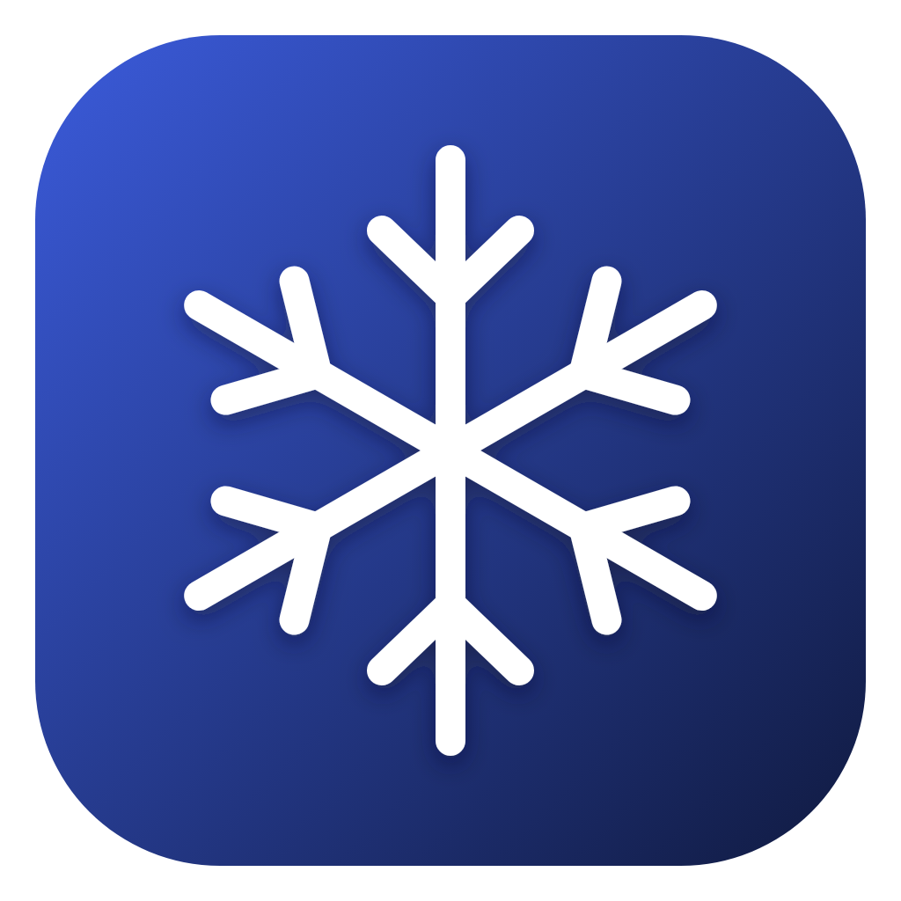
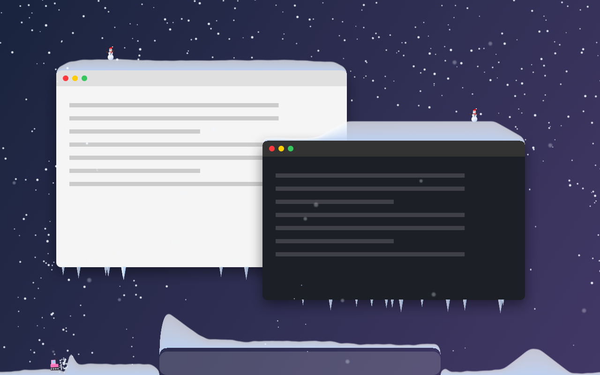
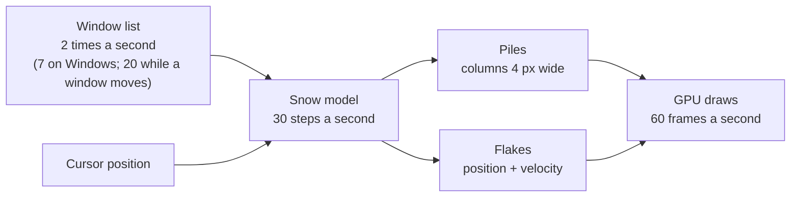
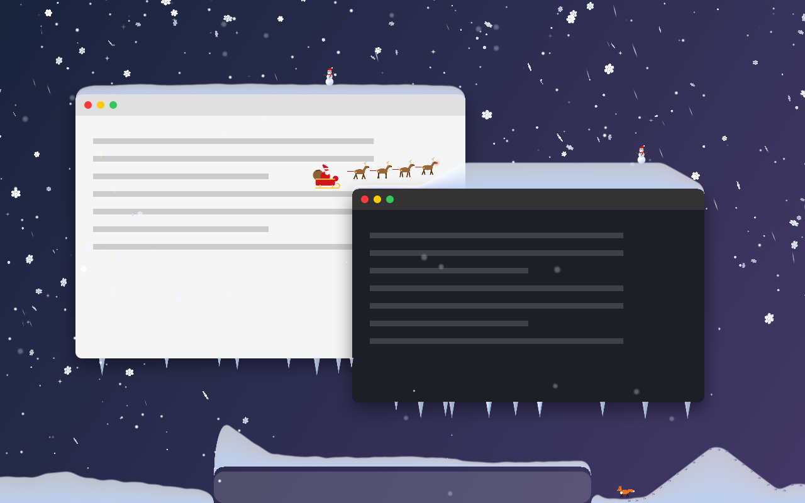
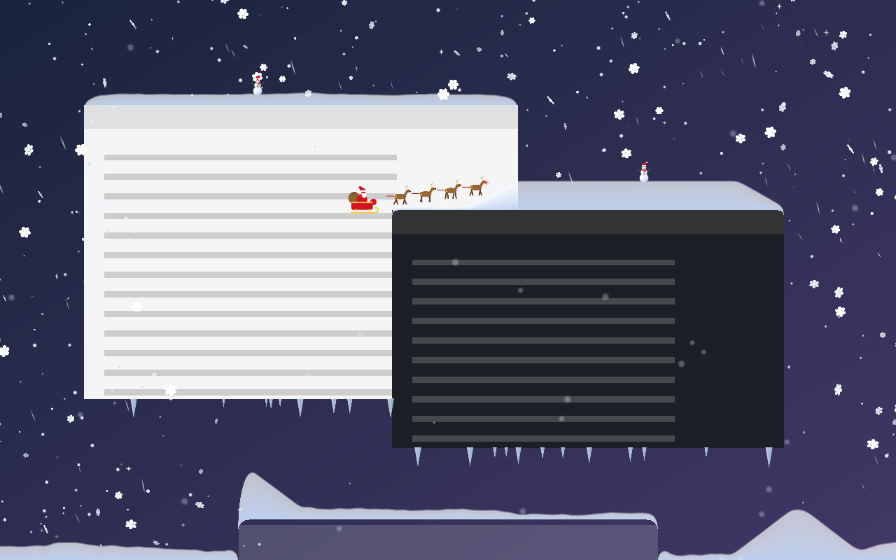

<p align="center"></p>
<h1 align="center">Quiet Snow</h1>
<p align="center"><b>Snow for your Mac or Windows desktop. It settles on your windows, slides off when you drag them, and stays out of your way.</b></p>
<p align="center">
  <a href="https://github.com/FinnTech3/quiet-snow/actions/workflows/ci.yml"></a>
  <a href="https://github.com/FinnTech3/quiet-snow/releases/latest"></a>
  
  
  
</p>
<p align="center"></p>
<p align="center"><sub>Real output from the app's own renderer (<code>QuietSnow --frames</code>) over a drawn desktop: a cursor sweeps a pile, then a window is dragged and its snow falls. <a href="https://raw.githubusercontent.com/FinnTech3/quiet-snow/assets/demo.mp4">Full quality MP4</a>.</sub></p>

<p align="center">
  <a href="https://github.com/FinnTech3/quiet-snow/releases/latest/download/QuietSnow.zip"><b>Download for Mac</b></a>
  &nbsp;·&nbsp;
  <a href="https://github.com/FinnTech3/quiet-snow/releases/latest/download/QuietSnow-Windows.zip"><b>Download for Windows</b></a>
</p>

## The straight answer

- **What it is.** A tray or menu bar icon and a see-through layer over your desktop. No windows to manage, no account, no network.
- **What it does.** Snow falls, lies along the tops of your windows and the Dock or taskbar, slides off when you move a window, and flies when you sweep the cursor through a pile. Piles have a soft top and round off down the corners of each window. Click the snow to scoop up a snowball, drag it through more snow to make it grow, and stack three for a snowman. A pink snow plough clears the bottom of the screen, and Santa's sleigh clears deep windows and flattens snow mountains.
- **What it costs.** About 44 MB of memory on a Mac and, in CI, 5 to 8% of one core ([the numbers, and why to doubt them](#numbers)). It stops completely when the screen sleeps or locks.
- **What I have not done.** Watched it on a real desktop. CI builds both apps and renders real frames, but [that is all I can claim](#what-is-and-is-not-proven).

## Run it in 60 seconds

**Windows** (Windows 10 version 2004 or later, anything with DirectX 11): download the zip above, unzip it, double-click `QuietSnow.exe`. The snowflake lives in the tray (under the ^ arrow if Windows hides it). There is no installer; the zip holds the program, the licence and a short readme.

**Mac** (macOS 13 or later, Apple Silicon or Intel): download the zip above, unzip it, open `QuietSnow.app`. Or, in Terminal:

```sh
curl -fsSL https://raw.githubusercontent.com/FinnTech3/quiet-snow/main/install.sh | sh
```

That script is a dozen lines: [read it first](install.sh) if you like. It puts the app in `~/Applications`, asks for no password and starts it. The snowflake lives in your menu bar.

<details>
<summary>Windows or macOS shows a warning on the download?</summary>

I have not bought code signing certificates yet, so neither system has seen this program before, and both are cautious with anything new. Browsers and SmartScreen judge unsigned files by how many people have downloaded them, which for a new program is not many. It is not a sign that anything is wrong with the file, but you should not take my word for it. You can check:

- **Compare the hash.** Every Windows release carries `SHA256SUMS-Windows.txt`. In PowerShell, `Get-FileHash .\QuietSnow-Windows.zip` should print the same value for the zip.
- **Check where it was built.** The Windows zip is built by the public CI run for that release, from the source at that tag, and carries a build attestation that `gh attestation verify QuietSnow-Windows.zip --repo FinnTech3/quiet-snow` can check.
- **Read it or build it.** The Windows source is about 1,300 lines of C++, and [Build it yourself](#build-it-yourself) is three commands. The program makes no network connections: it does not link the networking libraries at all.
- **Mac.** The app is ad hoc signed, not notarised, so a browser download may need allowing once in System Settings, Privacy and Security. The one-line install above uses `curl`, which does not mark files as downloaded from the internet.

If a virus scanner flags it, I expect a false positive on a new unsigned program, but check the hash and the build first, then [tell me](https://github.com/FinnTech3/quiet-snow/issues) and report the file to the vendor (Microsoft takes submissions at <https://www.microsoft.com/wdsi/filesubmission>).

</details>

<details>
<summary>Remove it</summary>

Choose Quit from the tray or menu bar icon first. If you switched on "Open at login", switch it off in the same menu. Then delete the folder or app you put it in. On a Mac that is `~/Applications/QuietSnow.app`. On Windows it is wherever you unzipped it. Settings live under `HKEY_CURRENT_USER\Software\FinnTech3\QuietSnow` on Windows and in the app's preferences on a Mac.

</details>

## See it

<table>
  <tr>
    <td width="50%"></td>
    <td width="50%"></td>
  </tr>
  <tr>
    <td align="center"><sub>Mac (Metal)</sub></td>
    <td align="center"><sub>Windows (Direct3D 11)</sub></td>
  </tr>
</table>

Both are frames from the real renderers, drawn over a mock desktop by CI. Look for the soft blue shading at the base of each pile, the snow rounding off down the window corners, the snowmen, the plough on the bottom edge, and the few big blurred flakes that never land: those are what give it depth.

## Using it

Click the snowflake.

| Item | What it does |
|---|---|
| Light, Steady, Flurry | How much falls. Scales with your screen size, capped at 5,000 flakes. |
| Wind | Still air, a breeze or a gale, either direction. |
| Snow type | The shape of the flakes: Balls (the default), Snowflakes, Sleet, Sparkles, Hail, or Mix of all. See below. |
| Over all apps and screens | The default. Snow shows above every window on every display, including full screen apps. It rests on window tops and the Dock or taskbar. |
| Desktop only | Snow shows only on the desktop. It falls behind your windows, still piles up on their tops and on the Dock or taskbar, and disappears completely on a display where an app is full screen. It comes back when that app closes. |
| Snow toys: snowballs, snowmen, plough, sleigh | On by default. See [Snow toys](#snow-toys). Switch it off and the snow never takes a click. |
| Melt slowly | Piles thaw over a minute or two, so they never take over. Off by default. |
| Clear piles | Lets every pile go at once. |
| Pause | Freezes the snow where it is. |
| Show in screenshots (Mac only) | Off by default: screenshots and screen sharing see your desktop without snow. On Windows the snow is always visible to screenshots and screen sharing. |
| Open at login | Your call. macOS may ask you to approve it in System Settings. |
| Sharp on Retina (Mac only) | Draw at the display's real resolution. Off by default: it costs about four times the memory. |
| Pause with Ctrl+Alt+Shift+S | A global hotkey (Control+Option+Shift+S on a Mac) that pauses and resumes. Off by default. |
| Copy diagnostics | Puts your version, system, displays and settings on the clipboard, ready to paste into a bug report. |
| Check for updates | Opens the latest release page in your browser. The app itself makes no network connection. |
| Reset settings | Back to what a fresh install starts with. |

Your choices are remembered. If macOS "Reduce Motion" or the Windows "Animation effects" setting is off, a first run starts on Light. On Windows it also hides itself while Windows is in presentation mode. Drag a window and the snow around it gets pushed the way the window moves.

## How it works



Each window top is a strip of 4-pixel columns. A flake that lands adds to a column, steep slopes slump, a full column hands the flake to its lowest neighbour, and a window in front hides the columns behind it. Move a window and its pile is released as falling snow. The model steps 30 times a second and flakes glide on by their last velocity in between, so every one of the 60 frames moves for half the maths.

Every end of a pile that is not at a screen edge is rounded: the snow follows the window's rounded corner down (10 points on a Mac, 16 from macOS 26, 8 on Windows 11, square on Windows 10) and its top curves down to meet it.

**The Dock.** macOS does not tell an app where the Dock is: its window list reports the Dock as the whole screen, and the screen's visible area gives only its height. So Quiet Snow estimates the Dock's width from the Dock's own settings (icon size, the apps kept in it, running and recent apps, folders and the Bin) and puts the snow on the Dock with rounded ends, and on the bare bottom edge of the screen either side. It is an estimate: if the snow on your Dock is off by an icon or two, Copy diagnostics shows the numbers it used, and I want to see them.

## Snow toys

- **Snowballs.** Press on any pile of snow to scoop up a snowball. Keep the button down and drag it through more snow: it picks the snow up and grows, up to 90 points across. Let go and it drops where you are, thrown a little if you were moving. Snowballs you make never melt. Press on one to pick it up again.
- **Snowmen.** Drop three snowballs on top of each other and they become a snowman, with a Santa hat, scarf, carrot nose and stick arms, sized by the bottom ball. Snowmen also build themselves on deep snow on a window. Move the window or flick the cursor through one and it breaks into snowballs.
- **The plough.** Every 35 to 70 seconds a pink plough bounces along the bottom of the screen, puffing steam from its pipe, and pushes the snow off the screen, or into a heap against the Dock.
- **Santa's sleigh.** When a window gathers deep snow, Santa flies across it with his reindeer, Rudolph's nose glowing at the front, and takes the snow off. Snow on the floor can grow into mountains up to a third of the screen high. When one gets there, the sleigh flies left to right over and over, taking a layer off each pass, until it is low enough for the plough to clear the rest.

The snow is click-through everywhere else. The overlay takes a click only while the cursor is over snow or a snowball; on Windows the cursor turns into a hand there. Nothing hooks the mouse: the app changes its own window's click-through setting as the cursor moves.

## Snow types

| Type | What it looks like |
|---|---|
| Balls | Soft round flakes. The default. |
| Snowflakes | Six-armed crystals with branches, turning slowly. |
| Sleet | Thin streaks that fall faster, with a brighter head. |
| Sparkles | Four-point stars that twinkle. |
| Hail | Small hard pellets with a highlight, falling a little faster. |
| Mix of all | Every flake picks one of the above. |

The big soft flakes in the foreground are always round, whichever type you choose: they are there for depth. The picture below is real renderer output with Mix of all, Mac on the left and Windows on the right.

<table>
  <tr>
    <td width="50%"></td>
    <td width="50%"></td>
  </tr>
</table>

## Numbers

| | Resident memory | CPU (one core) | How measured |
|---|---|---|---|
| Mac, 60 fps | 44 MB | 5 to 8% (4.95% and 7.65%) | GitHub macOS runner, a virtual machine, empty desktop, 20 s window after 5 s start-up |
| Windows, 60 fps | 28 MB | 5 to 8% (4.8% and 8.1%) | GitHub Windows runner, no GPU, so Direct3D ran on the software renderer |

Read these as a ceiling for the Mac and a pessimistic case for Windows: both runners are virtual machines, the Windows one draws on the CPU, and the Mac readings differ by a third between two runs. A profile of the Mac build (macOS `sample`, 8 seconds) showed the main thread asleep for 96% of the time, and nearly all the rest inside Apple's own code for getting a drawable, submitting a frame and listing windows. I hold the line at 60 frames a second because snow that stutters looks cheap. If your Activity Monitor or Task Manager says otherwise, [tell me](https://github.com/FinnTech3/quiet-snow/issues).

## Why it's built this way

I wanted something you forget is running, so everything is about doing less.

- **One pixel per point.** The snow is soft, so a retina-sized buffer buys nothing and costs tens of megabytes. This is the single biggest saving. If you want it razor sharp, Sharp on Retina switches it off.
- **Nothing runs when nothing is visible.** Sleep, lock or Pause stop the frame loop completely. It blocks and nothing wakes up.
- **Maths and drawing are separate.** The model is plain Swift (and a hand port in C++ for Windows) with no windowing code, so it is tested on Linux, macOS and Windows in CI, including a 6,000-step fuzz run in the optimised build.
- **Public window bounds only.** It reads where windows are, never what is in them. No Screen Recording or Accessibility permission on a Mac, nothing at all on Windows.
- **Shaders compile at launch.** The Mac shaders are a few lines in the source, so building needs only the command line tools, not Xcode's Metal toolchain.

## What it won't do

- Snow on Dock icons, desktop icons or widgets. Window tops and the Dock or taskbar only.
- Side docks. A Dock or taskbar on the left or right is ignored.
- Know the Dock's exact width. It is estimated, as above. A Dock with magnification grows above the snow when you hover over it.
- Step aside for full screen apps unless you ask it to. In the default mode it runs over them (an exclusive full screen game draws over it regardless). Choose Desktop only and it hides itself there.
- Linux.
- Update itself. Choose Check for updates, download the new zip, or run the Mac install line again. Scoop users run `scoop update quiet-snow`.

## What is and is not proven

| | Mac | Windows |
|---|---|---|
| Builds in CI | yes, universal (Apple Silicon and Intel) | yes, single `.exe`, no runtime to install |
| Model tests | 51, pass | 49, pass |
| Swift and C++ models agree on two seeded scenarios (pile heights, flake counts, snowmen, plough, snowballs, a rolled ball, a flattened mountain) | within 5%, checked in CI | within 5%, checked in CI |
| Renders frames with the real shaders in CI | yes | yes, on the software renderer |
| Starts and keeps running for 25 seconds in CI | yes | yes |
| Watched on a real desktop by me | no | no |

"No" means window tops, the Dock or taskbar floor, click-through, the menu or tray, login item and multi-monitor layouts are written from the documentation and compile cleanly, but nobody has watched them work by eye. If something is off, tell me what you see and I will fix it. The Windows app is a separate C++ program in `windows/`: a tray icon, Direct3D 11 and DirectComposition.

## Build it yourself

Mac, with the Xcode command line tools:

```sh
git clone https://github.com/FinnTech3/quiet-snow.git
cd quiet-snow
./build.sh          # build/QuietSnow.app, universal, ad hoc signed
swift test          # the model, on any platform Swift runs
```

Windows with Scoop, no download page needed:

```sh
scoop bucket add finntech3 https://github.com/FinnTech3/quiet-snow
scoop install quiet-snow
```

Windows, from a Visual Studio developer prompt:

```bat
cl /std:c++17 /O2 /EHsc windows\tests.cpp /Fe:tests.exe && tests.exe
rc /nologo /fo QuietSnow.res windows\QuietSnow.rc
cl /std:c++17 /O2 /GL /EHsc /MT /DUNICODE /D_UNICODE windows\main.cpp /Fe:QuietSnow.exe /link /SUBSYSTEM:WINDOWS /LTCG QuietSnow.res
```

`QuietSnow --snapshot out.png` (Mac) or `--snapshot out.bmp` (Windows) renders the picture; `QuietSnow --frames dir` (Mac) renders the clip frames; `--version` prints the version. CI regenerates the pictures above on every push and publishes them to the `assets` branch. To make a release, run the CI workflow from the Actions tab and give it a tag such as `v1.0.1`.

## Finn's take

A desktop toy should cost nothing. If you can see it in Activity Monitor you have already lost, so every decision here is about what to leave out. The best compliment is that you stop noticing it, then it snows on a Friday and you smile.

Built by FinnTech3. MIT licence.
