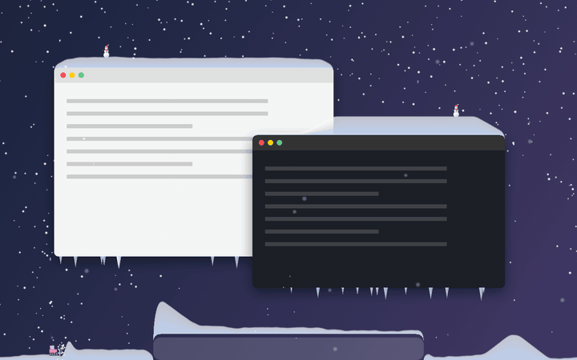
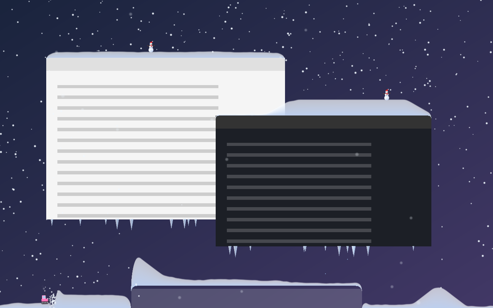

# Quiet Snow

Snow for your Mac or Windows desktop. It falls, settles on your windows and the Dock, slides off when you drag a window, and gets out of your way.



*This clip is real output: `QuietSnow --frames` runs the actual model and shaders offscreen over a drawn desktop. The cursor sweeps a pile, then a window is dragged and its snow drops. [Full quality MP4](https://raw.githubusercontent.com/FinnTech3/quiet-snow/assets/demo.mp4).*

## The straight answer

- One menu bar icon. No windows, no preferences pane, no account, no network.
- Snow lies along the tops of your windows and the Dock. Move a window and its snow drops. Sweep the cursor through a pile and it flies.
- It sits at the bottom of Activity Monitor on purpose: it pauses itself when the screen sleeps or locks and when macOS reports the overlay hidden, and in Low Power Mode it thins the snow out but never drops below 60 frames a second.

## Run it in 60 seconds

**Mac** (macOS 13 or later, Apple Silicon or Intel):

```sh
curl -fsSL https://raw.githubusercontent.com/FinnTech3/quiet-snow/main/install.sh | sh
```

[Download for Mac](https://github.com/FinnTech3/quiet-snow/releases/latest/download/QuietSnow.zip)

**Windows** (Windows 10 version 2004 or later, anything with DirectX 11), in PowerShell:

```powershell
irm https://raw.githubusercontent.com/FinnTech3/quiet-snow/main/install.ps1 | iex
```

[Download for Windows](https://github.com/FinnTech3/quiet-snow/releases/latest/download/QuietSnow-Windows.zip)

Both install into your own user folder, ask for no password and no permissions, and start straight away. Read [install.sh](install.sh) or [install.ps1](install.ps1) first if you like, they are a dozen lines each. The snowflake is in your menu bar on a Mac and in the tray on Windows (under the ^ arrow if Windows hides it).

If you download the Windows zip in a browser instead, Windows SmartScreen may warn about an unsigned program, because I have not paid for a signing certificate. The PowerShell line does not trigger that.

Remove it:

```sh
pkill -x QuietSnow; rm -rf ~/Applications/QuietSnow.app
```

```powershell
Stop-Process -Name QuietSnow; Remove-Item -Recurse "$env:LOCALAPPDATA\QuietSnow"
```

## Numbers

Measured in CI on a GitHub macOS runner (a virtual machine with a paravirtual GPU), empty desktop, one display, CPU over a 20 second window after 5 seconds of start-up (`tools/measure.sh`): **44 MB** resident and **5 to 8% of one core** at 60 frames a second (two runs: 4.95% and 7.65%, so the runner is noisy). An earlier build at 30 frames a second measured about 3%.

I profiled it too (macOS `sample`, 8 seconds, at 30 frames a second). The main thread was asleep for 96% of it. Of what is left, nearly all of it is Apple's code: getting a drawable, submitting the frame, and listing windows (about 0.5% of a core). My own model and geometry code did not show up as a notable cost.

On Windows, in CI: **26 MB** working set and **6.6% of one core** at 60 frames a second. That runner has no GPU, so Direct3D runs on the software renderer (WARP), which is far slower than a real graphics card; a machine with a GPU should cost much less. The app started and kept running there, which at least proves the overlay window and swap chain can be created.

I hold the line at 60 because snow that stutters looks cheap. A virtual machine is not a Mac and I have not measured a real one. If your Activity Monitor says otherwise, tell me.

## Using it

Click the snowflake.

| Item | What it does |
|---|---|
| Light, Steady, Flurry | How much falls. Scales with your screen size, capped at 3,500 flakes. |
| Wind | Still air, a breeze or a gale, either direction. |
| Melt slowly | Piles thaw over a minute or two, so they never take over. Off by default. |
| Clear piles | Lets every pile go at once. |
| Pause | Freezes the snow where it is. |
| Show in screenshots | Off by default: screenshots and screen sharing see your desktop without snow. |
| Open at login | Your call. It uses the system login item API, so macOS may ask you to approve it in System Settings. |

Your choices are remembered. If macOS "Reduce Motion" is on, it starts on Light.

## Why it's built this way

I wanted something you forget is running, so everything is about doing less.

- **One file of maths, no framework.** The model is plain Swift with no AppKit, so it is tested on both Linux and macOS in CI (24 tests). The app around it is AppKit and Metal only. No SwiftUI, no web view, no Electron.
- **One pixel per point.** The snow is soft, so rendering at retina size buys nothing and costs tens of megabytes of drawable memory. This is the single biggest saving.
- **60 frames a second, always.** On macOS 14 and later frames come from the display link, locked to 60 (a plain timer on macOS 13). The model itself only steps 30 times a second, and flakes glide on by their last velocity in between, so every frame moves and the maths costs half. Sleep, lock, hidden or paused all stop it completely. Nothing wakes up.
- **Draw data, not drawing.** Piles are rebuilt 15 times a second, since they change slowly, and the optimised build skips bounds checks. The model's own tests include a 6,000-step fuzz run in that exact build.
- **Depth for free.** One flake in twenty is big, soft and fast, and never lands. It costs nothing and it is what makes the scene feel three-dimensional.
- **Shaders compile at launch.** The two shaders are a few lines in the source, so building needs only the command line tools, not Xcode's Metal toolchain.
- **Piles are a row of columns.** Each window top is a strip of 4-point columns. Flakes add to a column, steep slopes slump, and a flake that lands on a full column goes to its lowest neighbour. A window in front hides the columns behind it.
- **Public window bounds only.** It reads where windows are, never what is in them, so it needs no Screen Recording or Accessibility permission on a Mac, and nothing at all on Windows.

## What it won't do

- Snow on Dock icons, desktop icons or widgets. Window tops and the Dock only.
- Side Docks. A Dock on the left or right is ignored.
- Show over full screen apps. It stays out of the way there.
- Linux.
- Update itself. Run the install line again.

## Windows, honestly

The Windows app is a separate program in `windows/`: plain C++, a tray icon, Direct3D 11 and DirectComposition, no runtime to install. The snow model is a hand port of the Swift one (`windows/sim.hpp`) with the same 24 tests, run in CI. CI also builds the app, renders a snapshot with the real shaders (`windows-snapshot.png`, on the software renderer because the runner has no GPU) and measures it.



What I have not done is watch it on a real Windows desktop. Window tops, the taskbar floor, click-through, the tray menu and multi-monitor layouts are written from the documentation and compile cleanly, but they are untested by eye. If something is off, tell me what you see and I will fix it.

## Build it yourself

Mac, with the Xcode command line tools:

```sh
git clone https://github.com/FinnTech3/quiet-snow.git
cd quiet-snow
./build.sh          # build/QuietSnow.app, universal, ad hoc signed
swift test          # the model, on any platform Swift runs
```

Windows, from a Visual Studio developer prompt:

```bat
cl /std:c++17 /O2 /EHsc windows\tests.cpp /Fe:tests.exe && tests.exe
cl /std:c++17 /O2 /GL /EHsc /MT /DUNICODE /D_UNICODE windows\main.cpp /Fe:QuietSnow.exe /link /SUBSYSTEM:WINDOWS /LTCG
```

`QuietSnow --snapshot out.png` (Mac) or `--snapshot out.bmp` (Windows) renders the picture; `--version` prints the version.

## Finn's take

A desktop toy should cost nothing. If you can see it in Activity Monitor you have already lost, so every decision here is about what to leave out. The best compliment is that you stop noticing it, then it snows on a Friday and you smile.

Built by FinnTech3. MIT licence.
